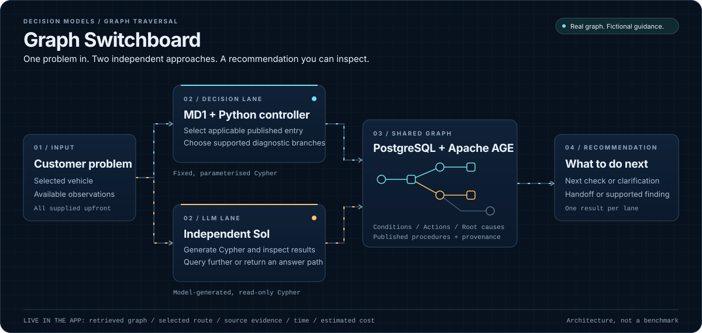

# Decision models

Practical demos exploring where decision models fit alongside LLMs.
Each demo has its own application, prerequisites and getting-started guide.

## Start here: AI Switchboard

The simplest demo: choose an editable classification example and compare
**MD1, Astra, Sol and Luna** side by side. Eight fictional cases cover ticket
routing, complaint classification and agent selection.

**[Source and setup](demos/ai-switchboard/README.md)**

Run your own instance using the setup guide. Selecting **Run comparison** makes
four billable model requests against your configured deployments; use fictional inputs only.


## Next: Graph Switchboard

Go beyond classification: give **MD1 and Sol** a customer problem and available
observations, then inspect how they independently use a real **PostgreSQL /
Apache AGE** troubleshooting graph to recommend what to do next.

**[Source and setup](demos/graph-switchboard/README.md)**

Run your own instance using the setup guide. Selecting **Get recommendation**
invokes your configured models and incurs charges; use fictional inputs only.



## Then: Shelf Check

Decisions about images: **Decision-1.1** audits store photos against retail
campaign policies. GPT-6 Sol extracts checks from each campaign brief once; then
every visit is judged against every campaign in one request. New campaign, new
questions, no retraining. Three scenarios: a drinks fridge, a coffee shelf and a
clothing display compared with a lookbook.

**[Source and setup](demos/retail-compliance/README.md)**

Run your own instance using the setup guide. Selecting **Run audit** invokes your
Decision-1.1 deployment and incurs (very small) charges. Store images are
AI-generated and brands are fictional.



## Get the source

```powershell
git clone https://github.com/Jbetts05/decision-models.git
Set-Location decision-models
```

Start with **[AI Switchboard](demos/ai-switchboard/README.md)**, then explore
**[Graph Switchboard](demos/graph-switchboard/README.md)** for graph traversal
and **[Shelf Check](demos/retail-compliance/README.md)** for image decisions.
There is no shared root install: each demo owns its dependencies and configuration.

## Repository layout

```text
demos/
  ai-switchboard/       Basic classification comparison: start here
  graph-switchboard/    Application, data, tests, infrastructure and setup guide
  retail-compliance/    Shelf Check: image-based campaign audits with Decision-1.1
  live-vision/          Decision-1.1 image API probes (limits, batching)
docs/
  proposals/           Ideas that are not implemented demos
```

Future demos belong in their own `demos/<name>/` directory. Keep setup,
dependencies, configuration examples and tests with the demo; add it to the
catalogue when it is runnable. Do not present proposals as working applications.

The [live vision proposal](docs/proposals/live-vision.md) includes an initial
[live Decision-1.1 image capability probe](demos/live-vision/README.md).
The webcam application is not implemented; object localization remains an open
scope decision.
