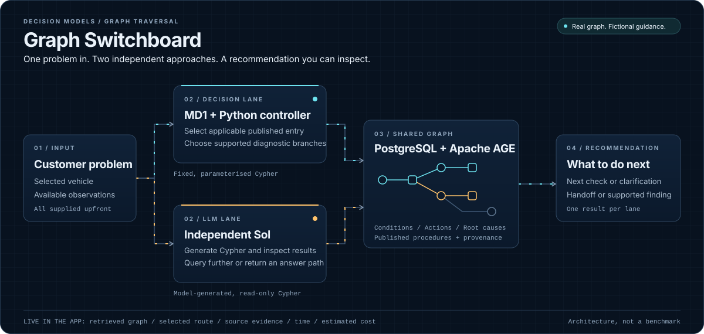

# Graph Switchboard

**One customer problem. Two independent approaches. A recommendation you can inspect.**

Compare **Microsoft Decision-1 (MD1)** with **Sol** against a real troubleshooting
graph in **PostgreSQL with Apache AGE**. See the database reads, selected graph
routes, supporting evidence, response time and estimated token cost side by side.

**[Run locally](#get-started)**

Run your own instance using the instructions below. Selecting **Get recommendation**
invokes your configured models and incurs charges; use fictional inputs only.



*The animation illustrates the architecture, not measured speed or a recorded
model run. The application visualises actual returned graph data.*

## Get started

### 1. Check prerequisites

- **Python 3.10+**, **Docker with Compose v2**, and **Azure CLI**. Start Docker
  Desktop before continuing.
- A **Microsoft Foundry resource** with deployed **Decision-1** and **Sol**
  models. You need their resource endpoint and deployment names, plus permission
  to call both deployments. Deployment names are not necessarily model names.

This setup starts a local database; it does **not** provision Azure resources
or deploy models. There is no simulated-inference mode.

### 2. Set up once

Run in PowerShell from the repository root:

```powershell
Set-Location demos\graph-switchboard
python -m venv .venv
.\.venv\Scripts\python.exe -m pip install -r requirements.txt
Copy-Item config.example.json config.local.json
az login
```

In `config.local.json`, replace these values with your own:

```json
{
  "endpoint": "https://YOUR-RESOURCE.cognitiveservices.azure.com",
  "subscription": "YOUR-SUBSCRIPTION-ID",
  "decision_deployment": "YOUR-DECISION-DEPLOYMENT",
  "baseline_deployment": "YOUR-SOL-DEPLOYMENT"
}
```

Keep the other example settings. Use the Foundry **resource endpoint**, not a
project URL or an inference URL with a path. Verify the optional pricing matches
your deployments before presenting estimated cost. Configuration stays local;
no API key is required when using your Azure CLI identity.

### 3. Start

From `demos\graph-switchboard`:

```powershell
.\.venv\Scripts\python.exe -m traversal start
```

Open **http://127.0.0.1:8766**.

The command checks configuration, validates the frozen dataset, starts
PostgreSQL/AGE, loads and verifies the graph, then serves the application.
It does not call a model until you select **Get recommendation**.
Run the same command next time; the graph and run history persist.

On macOS/Linux, use `cd demos/graph-switchboard`, create the environment with
`python3 -m venv .venv`, use `.venv/bin/python` for Python commands, and copy the
configuration with `cp config.example.json config.local.json`.

## Your first comparison

1. Choose a problem from **Example problem** and select **Get recommendation**.
2. Watch the two lanes retrieve graph data and select their routes independently.
3. Read the overall recommendation, then each lane's **Why this recommendation**
   and source reference. Inspect **Key execution** for actual model/database I/O.

Try a washer-delivery complaint first: without test records, a next diagnostic
check is the appropriate result. Then choose its version under **Problems with
workshop records already available** to see how supplied evidence can support a
longer route and a finding. All records are visible before submission; the
application never drip-feeds observations or pretends to perform tests.

**Answer route** shows the lane's selected path. **All retrieved** shows its
wider database results, not additional tests performed. Calls, graph queries and
path hops are different counts. A finished lane freezes its own metrics without
waiting for the other. Download is available after the paired result is saved.

## How it works

| MD1 + Python controller | Independent Sol |
| --- | --- |
| Fixed, parameterised Cypher retrieves published entry points applicable to the selected vehicle. | Starts with the same customer input, vehicle, observations and graph schema. |
| MD1 reads the original problem, observations and entry criteria to select a starting Condition, clarification or unsupported scope. | Generates read-only Cypher and inspects its own returned graph data to resolve the entry and relevant guidance. |
| Python retrieves valid next steps. MD1 chooses between RESULT branches; mandatory single-edge steps need no model call. | Can retrieve an entire procedure in one query or request more reads before returning an answer path. |
| Returns the next check, clarification, handoff or supported finding. | Returns its own recommendation with a structurally validated graph path. |

Neither lane gets the other's selected entry, conversation or retrieved context.
The controller is Python code, not a hidden LLM. Expected answers are used for
scoring only, never supplied to either model. This compares **architectures**,
not just model names.

### The graph

The frozen v4.2.0 corpus has **10 fictional vehicle configurations,
37 procedures, 417 nodes and 423 relationships**.

| Node | Meaning |
| --- | --- |
| `VehicleModel` | Vehicle make, model, year and configuration boundary. |
| `Procedure` | Versioned, published troubleshooting guidance and provenance. |
| `Condition` | An initial symptom or established diagnostic state. |
| `Action` | A question, inspection, measurement or test. |
| `RootCause` | A terminal finding supported by the procedure, not a repair instruction. |

```text
Procedure --APPLIES_TO--> VehicleModel
Procedure --ENTRY_POINT--> Condition
Condition --NEXT_ACTION--> Action
Action --RESULT--> Condition or RootCause
```

`RESULT` edges describe possible outcomes. Supplied observations determine which
branch is supported; neither model performs a physical test. The schema also
allows `INDICATES`, but this corpus contains no such edges. Session state and
evidence remain outside the graph. Source guides and dataset hashes are in
[`data/traversal/`](data/traversal/).

## Costs, data and limitations

- Live comparisons call your Foundry deployments and incur charges. The server
  admits one comparison at a time and defaults to 1,000 attempted model calls
  per UTC day. A comparison reserves up to 21 calls before admission.
- Questions, supplied records and model outputs go to your configured Foundry
  resource and are persisted in PostgreSQL and under `results/local/interactive/`.
  **Do not enter real customer, vehicle or confidential data.**
- Guidance is fictional, not manufacturer service information. No ingestion
  pipeline, repairs or real-world diagnostic accuracy claim is included.
- Both models can make mistakes. Disagreement and failures remain visible;
  a structurally valid path does not prove the diagnosis is correct. MD1 has
  produced an unnecessary clarification where the supplied records supported
  a workshop handoff. Do not present selected examples as a held-out benchmark.
- The default MD1 threshold is `0.0`, explicitly untuned. Option scores are not
  calibrated root-cause probabilities.

## Stop and troubleshoot

Use **Ctrl+C** to stop the app. To stop the local database without deleting data:

```powershell
docker compose stop
```

| Problem | What to check |
| --- | --- |
| Docker cannot connect | Start Docker Desktop; run `docker compose version`. |
| Missing settings or `YOUR-...` values | Finish editing `config.local.json` in this demo directory. |
| Foundry 401/403 | Run `az login`; check the configured subscription and inference permission. |
| Deployment not found | Use the deployment names from your Foundry resource. |
| Port 55432 or 8766 is busy | Stop the specific conflicting service. Serve on a different UI port with `start --port 8767`. |
| HTTP 429 / busy / daily limit | Wait for the active run or the next UTC day; do not reset the durable ledger. |
| No estimated cost | Configure verified deployment-specific rates in `pricing`; missing rates are not zero. |

The Compose project retains its original name, `decision-models`, so existing
local graph volumes and usage history are preserved after repository reorganisation.

## Going deeper

- [Development and checks](docs/development.md)
- [Deploy your own Azure instance](docs/deployment.md)
- [Historical evaluation and development notes](docs/graph-switchboard-history.md)
- [Historical acceptance register](docs/demo-rebuild-review.md)
- [Editable overview source](docs/images/overview.excalidraw)

For shared hosting, the owner must configure Azure explicitly. GitHub Pages
cannot run this Python/database/Foundry application.
