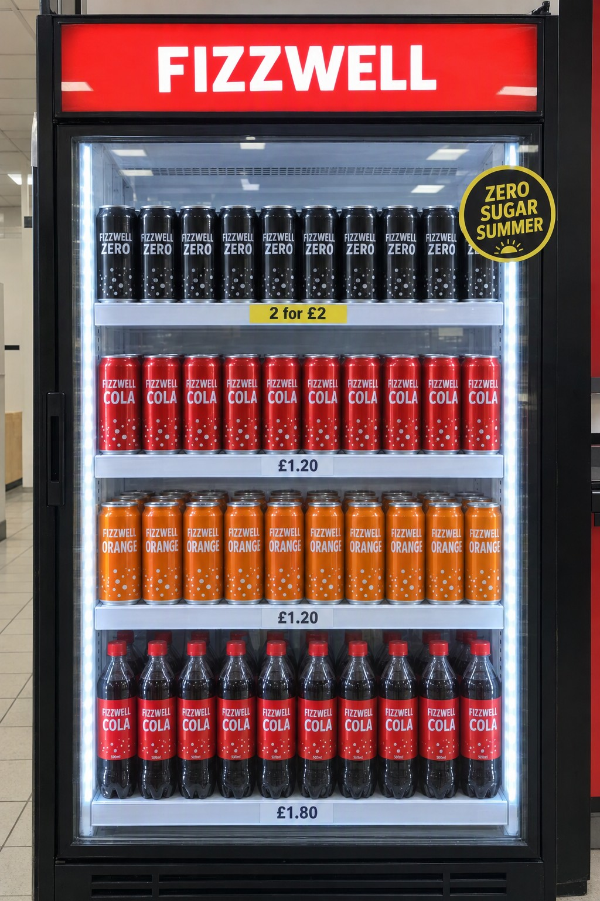
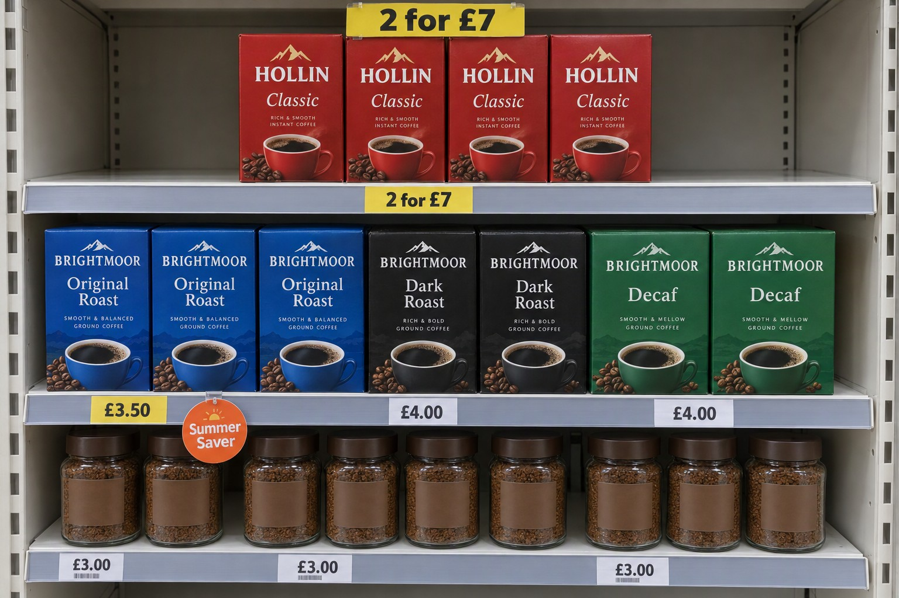
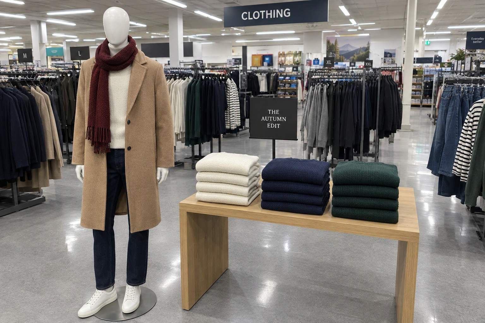

# Shelf Check

**Store photos in. Campaign verdicts out. New campaign, new questions, no retraining.**

Brands pay retailers for promotions and displays, then send field reps to photograph
stores and check what was actually built. Shelf Check audits those photos against
campaign policies with **Microsoft-Decision-1.1**: every check, for every live
campaign, answered in one request per store visit.

The web demo starts where a rep starts: with the **campaign documents** the store was
sent, shown as documents rather than extracted rules. Below them are **three store
visits per scenario** to audit. The extraction step that turned the documents into
checks is in the **trace**.

**[Run locally](#get-started)**

Run your own instance using the instructions below. **Run audit** and **Audit all
visits** call your Decision-1.1 deployment and incur (very small) charges.



*The animation illustrates the flow, not measured speed or a recorded run.*

## How it works

```text
Campaign briefs + standards (scenarios/*/policies/)
      │  GPT-6 Sol, once per campaign: extract checks; set aside what a photo can't show
      ▼
Bounded checks (scenarios/*/questions/)  ──  reviewed and edited before use
      │
      ▼
Microsoft-Decision-1.1, one request per visit: each check sees only the photos it needs
      ▼
Pass / Fail / Review for every campaign
```

The generative model does the expensive interpretation once. The decision model does
the repetitive visual judgement every visit. When a campaign changes, only the
questions change: no new model, labels or training.

- **Each check** becomes a Decision-1.1 `choice` question with the options
  *compliant*, *not compliant* and *cannot assess*, and is sent only with the photo
  types it lists (plus the campaign lookbook, for clothing).
- **A check with no matching photo** is recorded as *cannot assess* without a model call.
- **A confidence gate:** a compliant or not-compliant answer below 50% probability
  is sent to review instead of being automated, following Microsoft's guidance to
  escalate low-confidence decisions.
- **Campaign verdict:** *Fail* if any check fails; otherwise *Review* if any check
  could not be assessed; otherwise *Pass*.
- **Each visit is checked against the campaigns live on the audit date.** On the
  coffee bay that is two brands at once, Brightmoor and Hollin, answered in the
  same request. The full evaluation set also checks every visit against every
  campaign, including ones not yet running, which mirrors a changeover audit: the
  same photos pass one campaign and fail the next.

## The web demo

Each scenario shows its live campaign documents and three visits, chosen to show
what the model can see: one correct build and two real-world faults. Every visit
has all its photos, so every check is answered by Decision-1.1:

| Scenario | Live campaigns (audit date) | Visits |
|---|---|---|
| **Drinks fridge** | Fizzwell Zero Sugar Summer (10 June 2027) | Built to the brief · Competitor water in the cooler · Door sticker missing |
| **Coffee shelf** | Brightmoor Summer Saver + Hollin 2 for £7 (3 June 2027) | Both built correctly · A Hollin pack inside the Brightmoor block · A crushed pack left on the shelf |
| **Clothing display** | Harlow & Pine Autumn Edit (2 September 2027) | Dressed to the lookbook · Scarf missing · Untidy jumper table |

All 12 campaign verdicts on these visits matched the expected output in three
repeat runs, at about 0.8 to 1.8 s per request. Individual checks below the 50%
confidence gate still show as *needs review* (one, on the crushed-pack visit). **They were picked because they
work**, and two of the questions were edited while choosing them (see
[development](#how-the-questions-and-labels-were-developed)). The full evaluation
set below includes the cases the model gets wrong. The live campaigns and visits are
the `demo` block in each `visits.json`.

## Scenarios

All brands, retailers, products and prices are fictional. **All store images are
AI-generated**, checked by hand; each scenario's `visits.json` records what every
image actually shows and the expected verdict per campaign.

| Scenario | Real-world practice | What it tests | Visits |
|---|---|---|---|
| **Drinks fridge** | Brands supply branded coolers on condition that only their products go inside ("cooler purity") | Planogram by shelf, competitor products, gaps, lights, door sticker, price labels | 7 |
| **Coffee shelf** | Two brands' promotions in one bay; prices, shelf placement, point-of-sale material | Reading prices, product order, gaps, a competitor pack inside a brand block, damage | 12 |
| **Clothing display** | Head office sends stores a lookbook to copy | **Comparing the store photo with a reference image** | 7 |

| Drinks fridge | Coffee shelf | Clothing display |
|---|---|---|
|  |  |  |

Each scenario folder contains:

- `policies/`: a standards document and two or three campaign briefs. They mix rules
  a photo can check with rules it cannot (deadlines, till prices, temperatures, size
  order) and subjective wording ("inviting, premium"), to test the extraction step.
- `questions/`: the extracted and reviewed checks per campaign. Each file records
  the extraction model and token usage, and every review edit with its reason.
- `visits.json`: each visit's photos, what they show, and the expected verdicts,
  plus a `demo` block naming the live campaigns and the three visits the web demo shows.
- `images/`: generated source images (`generated/`), each visit's ready-to-use photos
  (`visits/<id>/`), and the clothing lookbooks (`reference/`).

Visits have **different numbers of photos**, as real audits do: a full view plus
close-ups, some missing, one blurred and one cropped. Close-ups are crops of the
generated image, so they hold no more detail than the full photo; real close-ups would.

Prices in the documents are those **agreed with the retailer** and funded by the
brand: a UK supplier can recommend, but not set, a retailer's selling price.

## Results on the full evaluation set

Measured on 2026-11-26 against a `Microsoft-Decision-1.1` Global Standard
deployment, every visit against every campaign; questions extracted with GPT-6 Sol
(high reasoning effort).

| | Drinks fridge | Coffee shelf | Clothing display | Total |
|---|---|---|---|---|
| Campaign verdicts matching expected | 11/14 | 33/36 | 14/14 | **58/64** |
| Median request latency per visit (two runs) | 1.0 s | 1.5 s (1.4–2.2) | 1.7 s | |
| Questions per visit (median) | 29 | 37 | 16 | |
| Input tokens per visit (median) | 4,059 | 5,595 | 3,592 | |

| Expected verdict | Correct | Got instead |
|---|---|---|
| Pass (12) | 10 | 1 Review, 1 Fail |
| Fail (43) | 40 | 2 Review, **1 Pass** |
| Review (9) | 8 | 1 Fail |

All 26 visits cost about **$0.005** in total at $0.042 per million input tokens.
Two complete runs gave identical verdicts.

**Read these numbers carefully:**

- **Always answering "fail" would already score 43/64**, because most cells are
  off-campaign changeovers. The informative rows are expected *Pass* and *Review*.
- **The one false pass is a real miss:** a gap in the fridge's second shelf was
  judged compliant at 70%.
- **Two fails where pass or review was expected** came from weak answers: a
  Hazelnut price label at 51%, and Hollin checks on the photo with the top shelf
  cropped out.
- **Three decisions went to review** instead of the expected pass or fail (lights
  off, range on the wrong shelf, and the Orange Refresh sticker), each below the 50%
  gate. That is the gate working: uncertain answers reach a person instead of being
  automated.
- **This is not an accuracy benchmark.** It is 64 verdicts over 22 generated scenes,
  reused across campaigns and photo variants, with no per-check gold labels. Real
  store photos have glare, angles and clutter. Validate on your own photos before
  relying on any threshold.

### How the questions and labels were developed

The development history is part of the result, so it is recorded here:

1. GPT-6 Sol's first extraction produced 270 checks, many near-duplicate or about
   the photo itself. The prompt was tightened before any audit run: 83 checks.
2. Every check was reviewed before use. In this repository the reviewer was the
   demo's author working with an AI coding assistant (GitHub Copilot), not an
   independent retail expert; in production, the campaign owner should sign the
   checks off. Edits are listed in each question file's
   `review.notes`, for example removing a sticker-position detail and scoping a
   point-of-sale check so another brand's header card does not fail it.
3. **First audit run: 48/64.** Diagnosis found a question that counted the shelf
   label as a second header card, shelf-edge crops that cut off product names, and
   images below the API's 280 px minimum. Those were fixed and the 50% confidence
   gate added.
4. **GPT-6.2 Sol reviewed the data adversarially**, replaying all 64 verdicts
   against the images. It found a generated image that contradicted its own label
   (an extra layer under the puffer jacket; regenerated), checks that read
   "500 ml" from a photo, a too-literal "covering" rule, and two policy points that
   conflicted with UK rules (single-pack price display and HFSS multibuys). All were fixed.
5. **Run: 56/64.** Tuning stopped there for the evaluation set.
6. **Choosing the web demo's visits** exposed two weak questions, which were
   edited, and the full set was rerun (58/64). Both edits were made while looking
   at these images, so treat 58/64 as optimistic:
   - Brightmoor's "point-of-sale material does not hide a product or price" check
     sat at about 50/50 on every visit, including ones where nothing was covered,
     both as extracted and when reworded. It was removed; each price-label check
     already requires the label to be visible.
   - The fridge door-sticker question began "check the sticker's number,
     appearance and wording", which assumes a sticker exists. With the sticker
     missing, the model answered *cannot assess*. Reworded to ask whether a sticker
     is on the glass, it was correct on all seven fridge visits.

## Measured Decision-1.1 limits

From the API's own error messages, on 2026-11-25:

| Limit | Value |
|---|---|
| Images per call, **documented** in Microsoft's model card | 8 |
| Image assets per request, observed (undocumented) | 32 |
| Image references per question prompt, including the state | 8 |
| Questions per request | 255 |
| Image side length | 280 to 1568 px |
| Image formats accepted | PNG and JPEG |

Each visit uses at most 6 images (4 photos and 2 lookbooks), within the documented
limit. Photos are referenced only from the questions that need them, never from the
shared state, because state references count toward every question's limit. The
[batching probe](../live-vision/batching_probe.py) shows 32 images in one call works
today but is slower than parallel 8-image calls; the demo uses one call per visit,
in parallel.

## Get started

### 1. Check prerequisites

- **Python 3.10+** and **Azure CLI**. The runtime uses only the Python standard
  library; nothing to install.
- A **Microsoft Foundry resource** with a deployed **Microsoft-Decision-1.1**, and
  permission to call it (for example the *Cognitive Services User* role). To
  re-extract questions you also need a GPT deployment that supports structured
  outputs; the committed questions work without it.

### 2. Configure

From the repository root, in PowerShell:

```powershell
Set-Location demos\retail-compliance
Copy-Item config.example.json config.local.json
az login
```

In `config.local.json`, set your Foundry **resource endpoint** and deployment names.
The file is git-ignored. Authentication uses your Azure CLI identity; there is no
API key.

### 3. Run

```powershell
python -m compliance serve
```

Open **http://127.0.0.1:8780**, choose a scenario, read its campaign documents, pick
a visit and select **Run audit**. **Audit all visits** sends the three visits'
requests in parallel and shows a matrix of verdicts against the expected output.

Command-line equivalents:

```powershell
python -m compliance audit --demo                                  # the web demo's 9 visits
python -m compliance audit --scenario drinks-fridge --visit 03     # one visit, every campaign
python -m compliance audit --output results.local.json             # full evaluation set, 26 visits
python -m compliance extract --scenario drinks-fridge --force      # re-extract (replaces reviewed files)
python -m unittest discover -s tests                               # offline tests, no calls
```

Re-extraction overwrites the reviewed question files; review them again before use.
`prepare_photos.py` regenerates visit photos from `images/generated/` after a manifest
change and needs Pillow (`requirements-dev.txt`).

## Deploy your own Azure instance

Optional, and creates chargeable resources: an Azure Container Apps environment and
app, a Basic container registry, a Log Analytics workspace and a user-assigned
managed identity. The identity gets a custom role on your Foundry account that
allows only account read and decision-model inference
(`Microsoft.CognitiveServices/accounts/AIServices/providers/action`): it cannot list
keys or manage agents, files or deployments. Creating it needs permission to write
role definitions. The app is public and anonymous: visitors can only choose bundled
visits; at most four audits run at once, and each process admits at most
`-DailyMaxCalls` visit requests per UTC day (default 2,000). That is an admission
limit, not a spend ceiling (see below).
Requires PowerShell 7.2+ and Azure CLI with Bicep; the image is built in Azure
Container Registry, so Docker is not needed.

```powershell
.\infra\deploy.ps1 -SubscriptionId <id> -ResourceGroup rg-shelf-check -Location swedencentral `
  -FoundryResourceId <full resource ID of your Foundry account> -DecisionDeployment <deployment name>
```

The script contains no default subscription, resource or endpoint, and requires the
Foundry account to be in the same subscription. It runs one replica and scales to
zero when idle. The daily limit is held in memory, so it resets when the app restarts
or scales to zero; at about $0.0002 per visit request the exposure is small, but use
a shared store if you need a hard ceiling. Up to two short retries on rate limiting
are not counted against the limit.

## Limitations

- Generated images and fictional policies; not evidence of accuracy on real stores.
- The web demo's visits are hand-picked examples that work; see the full
  evaluation set for misses.
- Expected verdicts are per campaign, not per check.
- The confidence gate and the campaign rule are demo choices; tune thresholds on
  labelled photos from your own workload.
- The daily limit is in memory and resets when the app restarts or scales to zero.
- Decision-1.1 is not intended as the sole decision-maker for consequential
  decisions; here, uncertain results go to a person.
