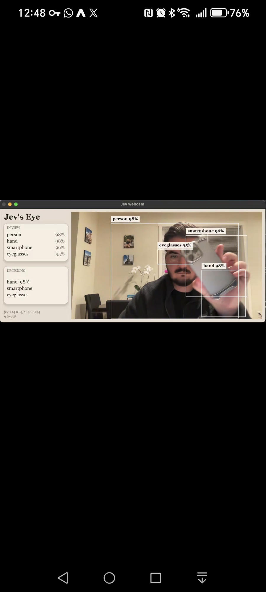

# Live vision decision demo

Status: design only. No application, model integration, or Azure resources are implemented by this document.

## Goal

Recreate the essential Jev's Eye experience as a simple, shareable, live webcam demo powered exclusively by a future image-capable Microsoft decision model deployed in a Microsoft Foundry resource in the owner's Microsoft tenant.

The future model's public name, API, image support, localization support, and performance are not yet known. "Decision Two" is a working description, not an announced product name or integration contract.

The deliverable today is an implementation brief. Do not build speculative adapters, mock endpoints, or simulated inference. Begin implementation when a suitable model is available, following the release-day runbook below.

## Confirmed scope

- One basic web page, shared through a URL.
- No application sign-in, user accounts, or authentication screens.
- All inference is live against the configured Microsoft deployment.
- A webcam feed, an "In view" panel, a "Decisions" panel, and compact live telemetry.
- Reuse the existing Decision One demo's visual language rather than introduce a new design system.
- No database, uploads, replay mode, model comparison, agent framework, or alternative inference provider.
- No persistent storage of camera frames or inference results.

## References and evidence

### Jev's Eye: behavior reference

Source: [Seth Nuzum's Jev's Eye demo post on X](https://x.com/Sethnuzum/status/2110753767150981509).

This reference is a demo shared on X using Jev to classify objects in live webcam
footage.

Reference image: the user-supplied screenshot is preserved in this repository at
[`jevs-eye-reference.png`](../images/jevs-eye-reference.png), so the
visual reference remains available without access to this conversation.



Use this screenshot as the behavior and layout reference, and the Decision One
demo below as the visual-style reference.

The supplied screenshot shows:

- A large live-camera area to the right of a narrow sidebar.
- White rectangular object outlines with attached text labels.
- An "In view" list containing person, hand, smartphone, and eyeglasses, with percentages.
- A separate "Decisions" panel containing hand, smartphone, and eyeglasses.
- A compact footer showing a model identifier, `4/s`, and a dollar amount.

The post states that JEV is called four times per second and describes identifying objects in frame. It does not establish the exact request schema, the meaning of "5 menus of items," how localization is produced, the semantics of each percentage, the Decisions panel's selection logic, or the dollar amount's accounting period.

Recreate the visible interaction, not an assumed internal implementation. A static screenshot does not establish temporal behavior or actual end-to-end latency.

### Decision One demo: UI reference

Repository: https://github.com/Jbetts05/decision-model-demo

Implementation reference: `web/index.html` on that repository's default branch, inspected on 2026-10-16. Before implementation, inspect its then-current appearance and record the commit used as the visual reference.

The inspected implementation uses a forced light theme, a warm off-white page (`#f7f4ef`), white cards, subtle gray borders (`#dedede`), dark text (`#242424`), muted secondary text, and a compact accent-colored primary button. Typography uses Segoe UI/Aptos/system fallbacks. Main content has a maximum width of 1120px, cards use rounded corners, and controls have a minimum height of 44px.

Reuse that page's light appearance, spacing, typography, restrained borders, cards, buttons, and status treatment. Its current accent is `#b11f4b`; this is a reference value, not a requirement to introduce that accent elsewhere. Do not default to a dark dashboard, recreate Jev's serif/beige styling, or reuse the Decision One demo's multi-model comparison layout.

## Page design

Working title: **Live vision decisions**. Display the actual configured model name once known; do not hard-code "Decision Two" as a released product.

Use a compact header with the title, model name, and connection state. Keep the camera and results immediately visible rather than add a large marketing hero.

Desktop layout:

```text
+-----------------------------------------------------------+
| Live vision decisions                 Model / status      |
| [Camera selector] [Start camera] [Stop]                    |
+------------------+----------------------------------------+
| IN VIEW          |                                        |
| Object labels    |          Live webcam feed              |
| Optional scores  |          + supported overlays          |
|                  |                                        |
| DECISIONS        |                                        |
| Live judgements  |                                        |
+------------------+----------------------------------------+
| Results age | Request latency | Completed requests/s       |
| Usage / estimated session inference cost, if available     |
+-----------------------------------------------------------+
| Camera frames are sent to the configured Microsoft model. |
+-----------------------------------------------------------+
```

On narrow screens, place the camera above the result panels. Preserve the video aspect ratio. Controls must be keyboard accessible and status/error text must not depend on color alone.

### Controls and states

- Start only after an explicit "Start camera" action. Show the frame-transmission disclosure before the action.
- Starting requests browser camera permission; never request microphone access.
- Permit camera selection where the browser exposes multiple devices.
- "Stop" stops frame transmission, stops camera tracks, clears displayed results, and invalidates any pending response. A request already accepted by the service may still finish and incur cost.
- Expose idle, requesting permission, connecting, live, paused, and error states in ordinary language.
- Pause frame transmission when the page is hidden; require Start to resume after returning. Do not silently resume paid inference.
- Camera denial, unavailable devices, unavailable configuration, unsupported model capability, throttling, timeouts, and service failures must have visible messages. Never substitute simulated success.
- A session limit or shared budget limit stops further transmission with a visible explanation.

### In view

Show the latest valid model observations as a compact object list. Prefer the reference's initial everyday-object vocabulary: person, hand, smartphone, and eyeglasses, subject to the released model's documented task support.

Only show scores if the model supplies them and their meaning is understood. Label them according to the API documentation; do not relabel arbitrary scores as calibrated confidence.

Render bounding boxes only if the Microsoft model supplies usable localization. Align them with the displayed image through resizing, cropping, and front-camera mirroring. Do not use a second detector or hand-authored coordinates to create an apparently Microsoft-generated result.

### Decisions

Keep this panel distinct from the object inventory. Its exact meaning in Jev's Eye is unverified.

Proposed behavior for this demo: display live, bounded visual judgements such as "Phone visible" and "Hand visible," using the same configured frame and Microsoft model. Do not infer identity, emotion, intent, or sensitive personal characteristics.

Finalize the small judgement set and its mapping to the model's supported task types during implementation. Do not add workflow automation, notifications, business-rule editors, or model-generated prose explanations.

### Freshness and telemetry

Associate every request with a frame identifier and capture time. Never apply an older result over a newer one or reuse results across a stopped/restarted camera session.

Clear observations and decisions after a successful empty result. On failures or delayed responses, mark existing results stale, show their age, and remove old overlays rather than present them as current. Choose and document the stale threshold after measuring the real deployment.

Show measured request latency and completed inference requests per second, separately from camera frame rate. Four requests per second is a reference target, not a performance claim or a requirement to create overlapping requests.

Show actual usage only where returned by the service. Estimated session inference cost requires verified pricing, deployment type, currency, a dated source, and a clearly defined session period. Otherwise display "Cost unavailable"; never show a zero or extrapolate the screenshot's dollar figure.

## Live architecture and sharing

```text
Browser camera -> same-origin backend -> Microsoft Foundry deployment
       ^                 |
       +--- results -----+
```

The browser captures frames; a small backend authenticates to the configured model and forwards validated requests. No Foundry key, service credential, or privileged access token may be embedded in browser code, URLs, or the repository.

"No authentication" means no end-user sign-in. The backend still authenticates to Foundry using a supported server-side identity or secret configuration. All inference must use the owner's configured Microsoft tenant and deployment.

Prefer a single shareable HTTPS deployment containing the UI and a small API. Azure Static Web Apps with an integrated API is an initial candidate, not a provisioning decision; verify current runtime, request-body, timeout, and model-networking compatibility before selecting it. GitHub Pages alone cannot provide the required credential-bearing backend.

Keep deployment straightforward: documented server-side settings, one deployment procedure, no required database or containers. Do not expose endpoint selection, credentials, or infrastructure settings in the public UI.

### Anonymous access and cost controls

Anyone able to reach an anonymous demo may trigger paid inference. Hiding credentials and restricting CORS do not prevent direct API use.

Before sharing, implement request-size limits, server-side rate and concurrency limits, bounded camera sessions, and an owner-configurable shared request or spending ceiling. Defaults must be chosen from actual model pricing and expected demo attendance. Do not depend solely on a browser timer or an in-memory counter that resets or diverges across backend instances.

Use hosting-level controls or a reliable shared limiter if needed; do not add a database by default. If the selected host cannot enforce the agreed limits, resolve that deployment constraint before publishing.

### Privacy and runtime handling

- Explain that frames leave the browser and are processed by the configured Microsoft deployment.
- Do not claim zero retention by the service; verify the deployment's actual data-handling terms.
- Do not log image payloads, image-bearing request bodies, credentials, or raw model responses. Verify hosting diagnostics do not capture those bodies.
- Operational logs may include request identifiers, durations, status codes, and aggregate usage.
- Bound frame size and resolution according to documented service limits.
- Begin with at most one in-flight request per camera session. Sample the newest frame when ready instead of queueing a video backlog.
- Bound request timeouts and retries. Respect throttling; do not create a rapid retry loop or silently amplify paid requests.
- Treat model responses as untrusted data: validate labels, scores, and coordinates, and render text safely.

## Release-day implementation runbook

1. Identify the released Microsoft model and verify that it is deployable in the intended tenant, Foundry resource, region, and available quota.
2. Read its official image-input, authentication, request/response, task-type, service-limit, pricing, and data-handling documentation. Record the model version and documentation sources.
3. Run a small live capability probe using non-sensitive test images. Verify object identification, the proposed bounded judgements, response structure, localization if available, usage fields, and observed latency.
4. Apply the capability gate: image input and suitable visual judgements are required. Localization is required for full Jev's Eye-style overlays. If missing, explicitly resolve whether to ship a label-only variant or wait; do not silently change the scope or add another model.
5. Inspect the Decision One UI reference and record its source commit. Reuse its visual patterns for the single-camera layout above.
6. Select the simplest compatible hosting option and define request limits, session limits, budget controls, and the stale-result threshold.
7. Implement the documented real model integration, the basic page, and runtime/error handling. Use the published API rather than inventing syntax in advance.
8. Verify the acceptance criteria against the deployed Microsoft endpoint, then publish the HTTPS demo URL and setup instructions.

## Acceptance criteria

- A colleague opens one HTTPS URL and starts a live camera session without application sign-in.
- Every inference result comes from the configured Microsoft model deployment; no mock, replay, cached demonstration, or secondary detector supplies results.
- The page visibly follows the referenced Decision One demo's light card-based UI, with a camera and the two result panels.
- The expected everyday objects and visual judgements update as objects enter and leave the frame.
- If supported, boxes remain aligned after resizing and mirroring. Unsupported localization is explicitly resolved before release.
- No invented scores, usage values, cost figures, model capabilities, or speed claims appear.
- Stop, hidden-page pause, and session expiry prevent new frame submissions. Late responses cannot repopulate cleared results.
- Delayed, malformed, failed, and out-of-order responses do not appear as fresh successful observations.
- Camera errors and model-service errors are visible and recoverable without a page reload where practical.
- Credentials remain server-side; application and hosting logs do not persist frames or image-bearing bodies.
- Anonymous-use limits are enforced server-side across the selected hosting topology, and reaching them produces a clear stopped state.
- Repository instructions cover prerequisites, deployment configuration, starting/stopping the demo, public inference exposure, and the model/version actually verified.
